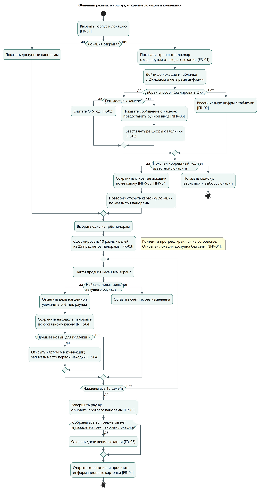
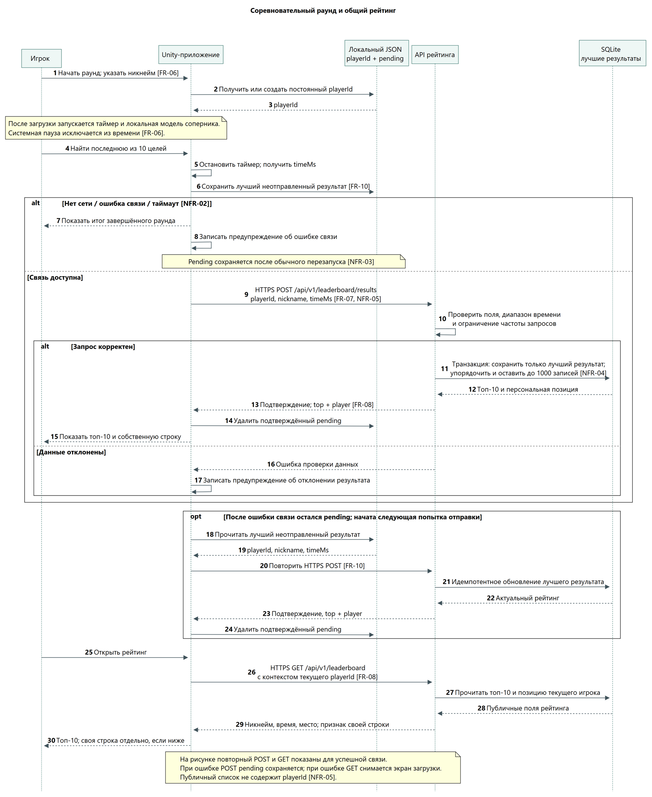
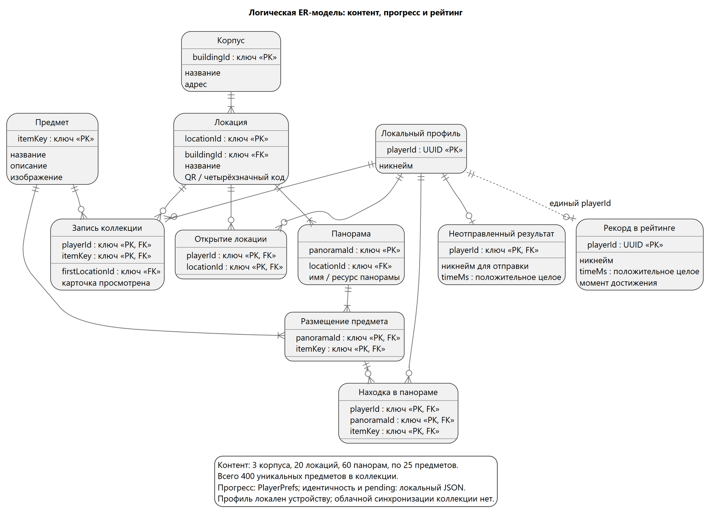
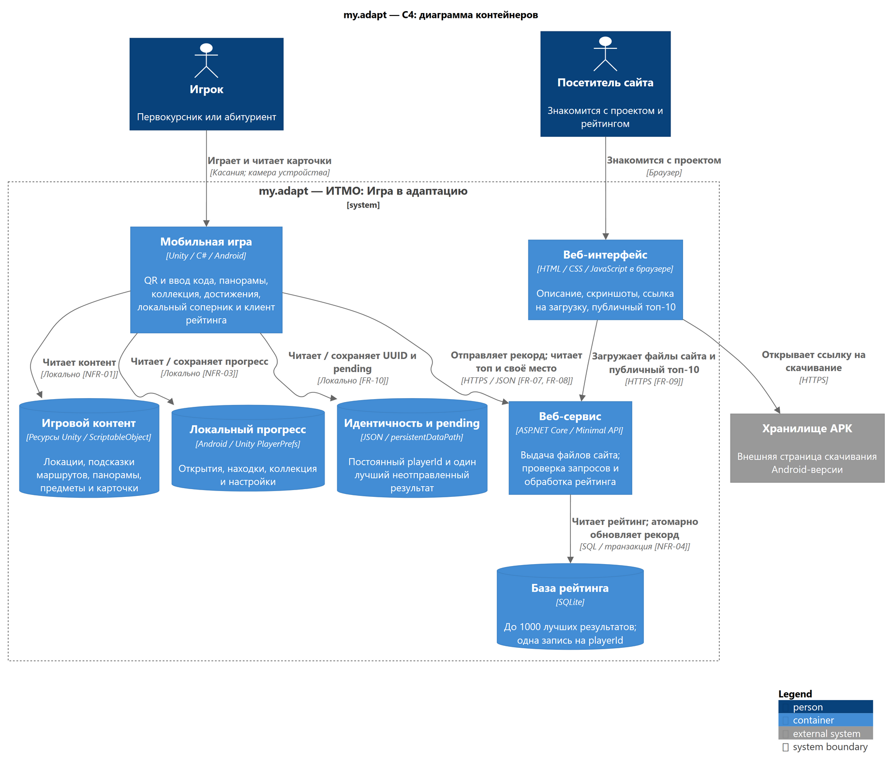
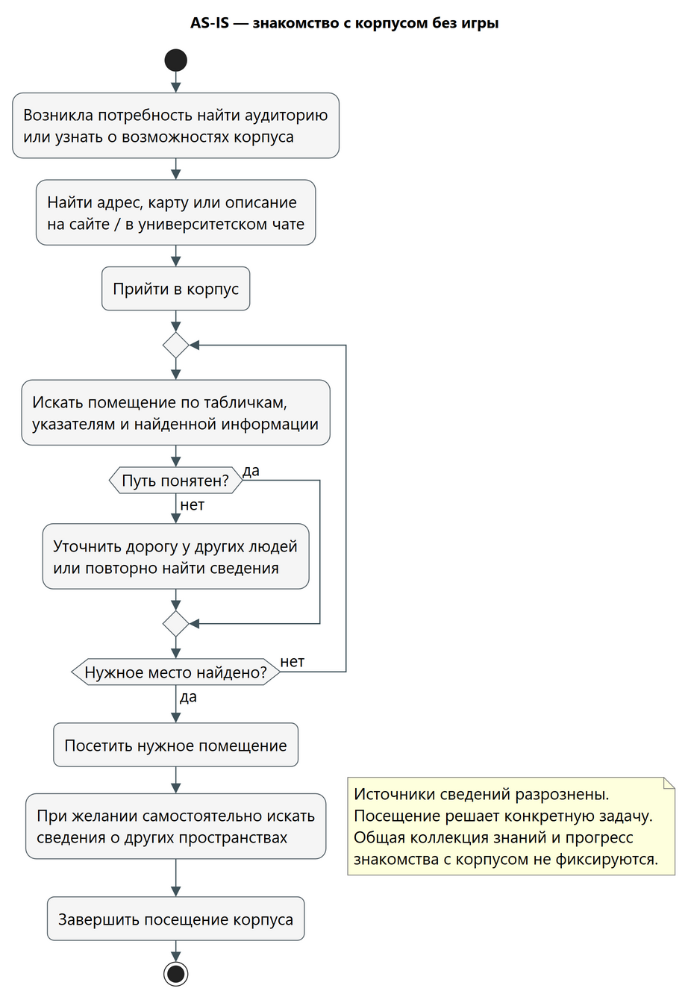
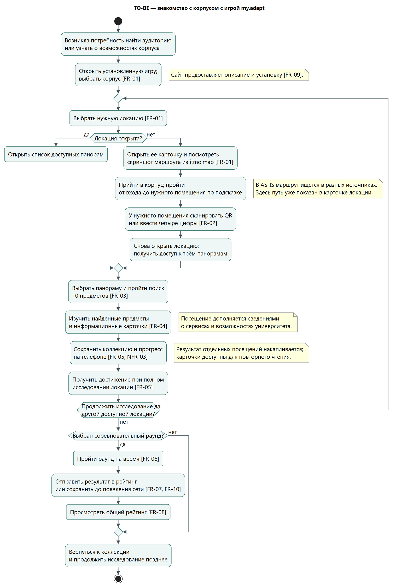

# ЛР 3 — проектирование

**Тема ВКР:** Мобильная игра для адаптации студентов в университете ИТМО.

**Автор:** Авокадо Ева Сергеевна.

**Продукт:** my.adapt («ИТМО: Игра в адаптацию»).

**Сайт проекта:** [итмоигравадаптацию.рф](https://итмоигравадаптацию.рф/). На сайте представлены описание проекта, скриншоты, ссылка для скачивания Android-версии и публичная таблица лидеров.

**Формат работы:** индивидуальный.

Была разработана горизонтальная мобильная игра для Android, объединяющая исследование трёх корпусов ИТМО с поиском предметов, коллекцией информационных карточек, достижениями и общим рейтингом. Обоснование актуальности, результаты опросов и скриншоты представлены в [лабораторной работе № 2](../research/report.md).

Контент включает **20 локаций по три панорамы — всего 60 панорам**. В каждой размещены 25 предметов: пять уникальны для этой панорамы, остальные 20 входят в общий пул повторяющихся предметов. Таким образом, 20 × 3 × 5 = **300 предметов, уникальных для панорам**; ещё **100 предметов составляют общий пул**. Вместе они образуют коллекцию из **400 уникальных предметов**. С учётом повторений в панорамах представлено 60 × 25 = **1500 размещений**.

## 1. Предметная область и требования

### Описание предметной области

Первокурсникам и абитуриентам необходимо освоить расположение университетских помещений и узнать, какие возможности доступны в кампусе. Сведения об аудиториях, учебных пространствах, сервисах и сообществах встречаются в разных источниках. Игра объединяет знакомство с ними в последовательный исследовательский процесс: просмотр маршрута к локации, посещение реального пространства, открытие локации QR-кодом, поиск предметов, изучение карточек и накопление прогресса.

Основной пользователь — студент или абитуриент, посещающий доступные ему пространства ИТМО. Дополнительный пользователь — посетитель сайта, знакомящийся с проектом и рейтингом. Подготовка панорам и размещение QR-кодов выполняются при наполнении проекта; редактор контента для пользователей в границы системы не входит.

В игре представлены корпуса на улице Ломоносова, 9, Кронверкском проспекте, 49, и Биржевой линии, 14–16. В отдельном раунде выбираются 10 целей из предметов панорамы; повторные прохождения позволяют завершить её исследование.

В обычном режиме накапливаются коллекция и прогресс исследования. В соревновательном режиме выполняется раунд на время с локально моделируемым соперником; результаты игроков объединяются через серверный рейтинг.

### Функциональные требования

| ID    | Требование                                                                                                                                                                                                                                  | Как проверить выполнение                                                                                                                                                                                          |
| ----- | ------------------------------------------------------------------------------------------------------------------------------------------------------------------------------------------------------------------------------------------- | ----------------------------------------------------------------------------------------------------------------------------------------------------------------------------------------------------------------- |
| FR-01 | Предоставлять выбор корпуса и локации. Для закрытой локации показывать скриншот маршрута из itmo.map от входа в корпус, для открытой — три панорамы. Каталог включает три корпуса, 20 локаций и 60 панорам.                                 | Открыть закрытую локацию и проверить маршрутную подсказку; открыть её кодом, повторно нажать на локацию и проверить появление трёх панорам. Сопоставить каталог с контентом сборки.                               |
| FR-02 | Открывать соответствующую локацию по выбору игрока: сканированием QR-кода или ручным вводом четырёх цифр с таблички. Ручной ввод доступен и без камеры. Повторное открытие не увеличивает прогресс; неверный код сопровождается сообщением. | Открыть локацию каждым способом, в том числе вручную при отказе в доступе к камере. Повторить ввод известного кода: число открытых локаций не увеличивается. Проверить неизвестный код и ошибку сканирования.     |
| FR-03 | Формировать раунд поиска из 10 разных целей среди 25 предметов панорамы и завершать его после нахождения всех целей.                                                                                                                        | Проверить состав целей и счётчик: одна цель учитывается один раз, касание другого предмета не увеличивает результат, десятая находка завершает раунд.                                                             |
| FR-04 | В обычном режиме добавлять найденные предметы в общую коллекцию и предоставлять карточки с изображением, описанием и местом первой находки.                                                                                                 | Найти предмет, открыть карточку, затем найти тот же предмет повторно: карточка остаётся одной, сведения о первой находке сохраняются.                                                                             |
| FR-05 | Накопительно учитывать найденные предметы каждой панорамы и открывать достижение локации после полного исследования её трёх панорам.                                                                                                        | Пройти несколько раундов; проверить накопление разных находок до 25/25 на панораме и получение достижения после завершения всех трёх панорам.                                                                     |
| FR-06 | Предоставлять соревновательный раунд с никнеймом, локальной моделью соперника и таймером от завершения загрузки до последней находки. Системная пауза исключается из времени.                                                               | Начать раунд, приостановить приложение, вернуться и завершить поиск; проверить старт, остановку таймера и исключение длительности системной паузы.                                                                |
| FR-07 | Передавать результат завершённого соревновательного раунда в общий рейтинг по playerId; сохранять не более одного рекорда игрока и заменять его только строго лучшим временем.                                                              | Для одного playerId отправить лучший, равный и худший результаты. Проверить единственную запись и сохранение минимального времени. Два разных playerId с одинаковым никнеймом должны оставаться разными игроками. |
| FR-08 | Показывать в игре топ-10 и собственную позицию без дублирования строки. Для мест 11–1000 выводить отдельную строку, для результата вне сохраняемой тысячи — обозначение «1000+» с локальными данными.                                       | Проверить отображение игрока в топ-10, на месте ниже десятого и вне тысячи. Сопоставить порядок записей со временем; при равенстве выше расположен более ранний рекорд.                                           |
| FR-09 | Предоставлять публичный сайт с описанием, скриншотами, ссылкой на загрузку Android-версии и топ-10 общего рейтинга.                                                                                                                         | Открыть сайт, перейти по ссылке скачивания и сопоставить веб-рейтинг с игровым при одинаковом состоянии серверных данных.                                                                                         |
| FR-10 | При отсутствии связи сохранять один лучший неотправленный результат и повторять его отправку при следующей попытке обращения к рейтингу. После подтверждения сервера удалять отправленную запись из ожидания.                               | Завершить несколько раундов без сети, перезапустить приложение и восстановить связь. Проверить отправку лучшего ожидающего результата и отсутствие повторной записи в рейтинге.                                   |

### Нефункциональные требования

| ID     | Требование                                                                                                                                                                                                                                 | Как проверить выполнение                                                                                                                                                                                                         |
| ------ | ------------------------------------------------------------------------------------------------------------------------------------------------------------------------------------------------------------------------------------------ | -------------------------------------------------------------------------------------------------------------------------------------------------------------------------------------------------------------------------------- |
| NFR-01 | Автономность основного сценария: выбор и прохождение открытых локаций, просмотр коллекции и сохранение находок доступны без интернета. Контент находится в сборке.                                                                         | После установки и открытия локации отключить сеть, пройти обычный раунд и открыть карточку. Сетевые запросы рейтинга не должны быть условием этих действий.                                                                      |
| NFR-02 | Устойчивость сетевого взаимодействия: запрос ограничен таймаутом из конфигурации; ошибка связи завершает состояние загрузки и сохраняет возможность пользоваться приложением.                                                              | При недоступном API дождаться настроенного таймаута, проверить снятие экрана загрузки и доступность других разделов. При ошибке отправки лучший pending должен сохраниться.                                                      |
| NFR-03 | Сохранность локального состояния при обычном закрытии и повторном запуске: открытия, находки, коллекция, playerId и pending восстанавливаются. Идентичность и pending хранятся отдельно от игровых настроек PlayerPrefs.                   | Закрыть и повторно открыть приложение после находки и неуспешной отправки; сравнить прогресс, UUID и ожидающий результат. Отдельно проверить, что сброс PlayerPrefs не удаляет файл идентичности и pending.                      |
| NFR-04 | Целостность данных: уникальные ключи локаций и предметов; одна находка на сочетание «профиль — панорама — предмет», одна карточка на «профиль — предмет». Обновление рейтинга и ограничение до 1000 записей выполняются одной транзакцией. | Повторить находку, сканирование и отправку одного результата; проверить отсутствие дублей. На тестовой БД выполнить параллельные обновления и проверить единственность записи на playerId, минимум времени и лимит 1000 записей. |
| NFR-05 | Разделение технической идентичности и публичных данных: обмен с веб-сервисом выполняется по HTTPS; публичные строки содержат никнейм, время и место без playerId. Входные поля проверяются сервером.                                       | Проверить адрес API и публичный JSON-ответ; убедиться в отсутствии playerId в общедоступном списке. Отправить недопустимый никнейм и время вне разрешённого диапазона — запись не должна добавляться.                            |
| NFR-06 | Понятность мобильного взаимодействия: горизонтальный интерфейс показывает маршрутную подсказку, цели и прогресс, объясняет ошибки QR и камеры. Игрок может выбрать ручной ввод кода независимо от доступности камеры. | На Android пройти основной сценарий касаниями, используя экранную клавиатуру для четырёхзначного кода и никнейма. Проверить видимость маршрута и счётчика, сообщения об ошибке и возможность открыть локацию без камеры. |

В контракте рейтинга допустимое время составляет от 10 секунд до 2 часов включительно (10 000–7 200 000 миллисекунд). Никнейм содержит 3–20 видимых символов: русские и латинские буквы, цифры, пробел, подчёркивание и дефис. HTML, ссылки и переносы строк отклоняются. Эти границы используются при проверке NFR-05.

Область сохранения локального прогресса — текущая установка приложения. Перенос коллекции между устройствами и восстановление идентичности после удаления данных требуют отдельного механизма учётных записей и в требования этой версии не включены.

## 2. Обзор нотаций и видов диаграмм

Сопоставлены восемь нотаций и видов диаграмм на основе спецификаций OMG и описаний IBM и C4 [1–5]. Виды UML выделены по задачам моделирования.

| Нотация или вид диаграммы                          | Что описывает                                                                | Сильные стороны                                                                                                               |
| -------------------------------------------------- | ---------------------------------------------------------------------------- | ----------------------------------------------------------------------------------------------------------------------------- |
| UML — диаграмма вариантов использования (Use Case) | Участников и доступные им функции системы.                                   | Помогает установить границы продукта и распределить функции между ролями. Удобна для первичного согласования состава системы. |
| UML — диаграмма деятельности (Activity)            | Последовательность действий, условия, ветвления и циклы процесса.            | Наглядно раскрывает игровой сценарий, ошибки и повторные действия; позволяет сопоставить AS-IS и TO-BE в одной нотации.       |
| UML — диаграмма последовательности (Sequence)      | Обмен сообщениями между участниками во времени.                              | Показывает порядок запросов, ответов и локальных операций, а также альтернативы при сетевых ошибках.                          |
| UML — диаграмма классов (Class)                    | Типы объектов, атрибуты, операции и связи программной модели.                | Помогает уточнять объектную структуру приложения и распределение ответственности в коде.                                      |
| ER — «сущность — связь», Crow’s Foot               | Сущности данных, ключи, атрибуты и кратности связей.                         | Выявляет отношения «один ко многим» и «многие ко многим», ограничения уникальности и основания для структуры хранения.        |
| DFD — диаграмма потоков данных                     | Источники и получателей данных, процессы преобразования, хранилища и потоки. | Позволяет проследить движение сведений через систему и найти избыточную передачу или недостающую обработку.                   |
| BPMN — модель бизнес-процессов                     | Работу участников процесса через события, задачи, шлюзы и обмен сообщениями. | Подходит для процессов с несколькими организационными ролями, например подготовки и проведения университетского квеста.       |
| C4 — диаграмма контейнеров (Container)             | Приложения и хранилища внутри системы, их назначение, технологии и связи.    | Даёт общий архитектурный обзор и показывает границы локальной работы, сети и серверного хранения.                             |

## 3. Выбор нотаций для проекта

Выбраны четыре вида моделей: UML Activity, UML Sequence, ER и C4 Container. Вместе они раскрывают пользовательскую логику, данные, взаимодействие частей системы и архитектуру.

| Нотация или вид диаграммы | Что моделируем | Связанные требования | Почему подходит |
|---|---|---|---|
| UML Activity | Открытие локации, раунд поиска, пополнение коллекции; процессы AS-IS и TO-BE. | FR-01–FR-05; NFR-01, NFR-03, NFR-04, NFR-06. | В игре важны условия: открыт ли QR-доступ, является ли нажатие новой находкой, завершён ли раунд и исследована ли локация. Ветвления и циклы показывают эти правила непосредственно. |
| UML Sequence | Завершение соревновательного раунда, отправка результата, повторная отправка и чтение рейтинга. | FR-06–FR-08, FR-10; NFR-02–NFR-05. | Порядок операций определяет сохранность результата: запись в ожидание должна предшествовать сетевой отправке, а очистка — следовать за подтверждением. |
| ER, Crow’s Foot | Иерархия контента, размещения предметов, открытия, находки, коллекция и результаты. | FR-01–FR-05, FR-07, FR-08, FR-10; NFR-03–NFR-05. | Позволяет разделить предмет и его размещение, общий прогресс коллекции и прогресс панорамы, локальные данные и серверный рекорд. |
| C4 Container | Unity-приложение, контент, локальные хранилища, веб-интерфейс, API, SQLite и внешняя загрузка APK. | FR-01, FR-04–FR-10; NFR-01–NFR-05. | Показывает, какие функции автономны, где возникают сетевые зависимости и какие данные пересекают границу устройства. |

## 4. Модели системы

В этом разделе подробно раскрыто устройство приложения. Сравнение знакомства с корпусом без игры и с игрой представлено отдельно в [разделе 5](#5-as-is-и-to-be); обе сравнительные схемы также выполнены в UML Activity.

### 4.1. Обычный режим — UML Activity

*Рисунок 1 — основной игровой сценарий в обычном режиме.*

[Исходник диаграммы](../../assets/design/01-gameplay.drawio).

Закрытая локация показывает маршрут до неё из itmo.map. Сканирование QR или ввод четырёх цифр открывает доступ к трём панорамам — FR-01 и FR-02. Ручной ввод остаётся доступен без камеры; сообщения об ошибках и управление касаниями отражают NFR-06. Ошибка завершает текущую попытку открытия с возвратом к выбору локаций.

Раунд завершается после нахождения 10 целей — FR-03. В обычном режиме каждая найденная цель отмечается в прогрессе панорамы; первая находка предмета открывает карточку и фиксирует место — FR-04. Повторная находка сохраняет эти сведения неизменными. Накопление 25 находок в каждой из трёх панорам открывает достижение локации — FR-05.

Локальные контент и сохранения обеспечивают автономность NFR-01 и восстановление прогресса NFR-03. Проверка повторных действий и составной ключ находки предотвращают повторный учёт — NFR-04.

### 4.2. Соревновательный раунд и рейтинг — UML Sequence

*Рисунок 2 — взаимодействие игрового клиента, локального хранилища и сервера рейтинга.*

[Исходник диаграммы](../../assets/design/02-leaderboard-sequence.drawio).

Таймер запускается после загрузки и завершается по окончании поиска; системная пауза исключается из времени — FR-06. Результат в миллисекундах передаётся вместе с playerId и никнеймом. Сервер сохраняет только строго лучшее время — FR-07; повтор запроса не создаёт новую запись игрока.

До сетевого запроса лучший ожидающий результат (pending) сохраняется локально. Ошибка связи оставляет его для повторной отправки; подтверждение сервера позволяет очистить ожидание — FR-10. Это связывает устойчивость к сбоям NFR-02 с сохранностью данных NFR-03. Ошибка проверки полей отделена от временной недоступности сети.

Транзакционное обновление и ограничение до 1000 записей отражают NFR-04. HTTPS, проверка входных полей и публичный ответ без UUID соответствуют NFR-05. Игровой интерфейс показывает топ-10 и собственную позицию без дублирования; вне сохраняемой тысячи используется метка «1000+» с подтверждённым локальным результатом — FR-08.

### 4.3. Структура данных — ER, Crow’s Foot

*Рисунок 3 — логическая модель данных и кратности связей.*

[Исходник диаграммы](../../assets/design/03-data-model.drawio).

Иерархия «Корпус — Локация — Панорама» и сущность «Размещение предмета» организуют контент — FR-01 и FR-03. Открытия обеспечивают доступ к локациям — FR-02. Находка относится к конкретной панораме, запись коллекции — к предмету в целом: два размещения одного предмета дают два факта прогресса и одну карточку — FR-04, FR-05. Их составные ключи отражают NFR-04.

Профиль связывается с единственным рекордом и одним ожидающим результатом — FR-07 и FR-10. UUID идентифицирует игрока, никнейм служит отображаемым именем и может повторяться. Место вычисляется из порядка рекордов — FR-08. Отделение публичных полей от технического ключа поддерживает NFR-05.

Модель логическая. Соответствие физическому хранению показывает, как выполняется NFR-03:

| Данные модели | Физическое представление | Назначение |
|---|---|---|
| Корпуса, локации, панорамы, предметы и размещения | Сцены, prefab, ресурсы Unity и ScriptableObject | Контент в составе установленной игры, доступный без API. |
| Открытия, находки, коллекция и настройки | Unity PlayerPrefs | Локальный накопительный прогресс. Связь с профилем в ER обозначает принадлежность текущей установке; отдельное поле playerId не добавляется к каждому ключу PlayerPrefs. |
| Постоянный playerId и лучший pending | JSON-файл в Application.persistentDataPath | Сохранение технической идентичности и отложенного результата отдельно от сбрасываемых игровых настроек. |
| Рекорды игроков | Серверная SQLite | Общий рейтинг, транзакционное обновление и хранение до 1000 лучших записей. |
| Счётчики, достижения и позиции рейтинга | Значения, вычисляемые из находок и рекордов | Представление прогресса без создания отдельной сущности на каждый экранный счётчик. |

Профиль обозначает состояние текущей установки. В PlayerPrefs нет отдельного playerId у каждого сохранения; внешние ключи между локальными хранилищами и SQLite физически не создаются.

### 4.4. Архитектура системы — C4 Container

*Рисунок 4 — архитектура my.adapt на уровне приложений и хранилищ.*

[Исходник диаграммы](../../assets/design/04-containers.drawio).

В C4 контейнер обозначает приложение или хранилище [5]. Unity объединяет игровой сценарий и клиент рейтинга — FR-01–FR-08, FR-10. Веб-интерфейс предоставляет публичную часть проекта и ссылку на внешнее хранилище APK — FR-09. ASP.NET Core обслуживает сайт и API, SQLite хранит рекорды.

Локальные контент и прогресс отделены от сетевого сервиса, поэтому обычная игра автономна и доступна при сбое API — NFR-01, NFR-02. Раздельное хранение PlayerPrefs и файла идентичности поддерживает NFR-03. Запись в SQLite через серверную транзакцию обеспечивает целостность NFR-04; HTTPS и граница публичного API отражают NFR-05.

### 4.5. Проверка согласованности моделей

Таблица связывает требования с элементами диаграмм и позволяет сопоставить процессы, данные и архитектуру.

| Требование | Элементы моделей |
|---|---|
| FR-01 | Рис. 1: каталог, маршрутная подсказка и три панорамы открытой локации; рис. 3: иерархия контента; рис. 6: путь к помещению. |
| FR-02 | Рис. 1: выбор сканирования или ввода четырёх цифр, проверка кода; рис. 3: «Открытие локации»; рис. 6: открытие у нужного помещения. |
| FR-03 | Рис. 1: 10 целей из 25 и цикл поиска; рис. 3: панорама, предмет и размещение. |
| FR-04 | Рис. 1: первая находка и чтение карточки; рис. 3: «Запись коллекции». |
| FR-05 | Рис. 1: накопительный прогресс и достижение; рис. 3: находки по панорамам; рис. 6: сохранение исследования. |
| FR-06 | Рис. 2: никнейм, таймер, локальная модель соперника; рис. 4: мобильная игра; рис. 6: необязательный соревновательный раунд. |
| FR-07 | Рис. 2: POST, серверная проверка и транзакция; рис. 3: один рекорд на UUID; рис. 4: API и SQLite. |
| FR-08 | Рис. 2: top + player и GET; рис. 3: время и момент достижения; рис. 4: чтение общего рейтинга. |
| FR-09 | Рис. 4: веб-интерфейс, веб-сервис и внешняя загрузка APK; рис. 6: знакомство с сайтом. |
| FR-10 | Рис. 2: запись pending, повтор и очистка; рис. 3: один ожидающий результат; рис. 4: локальный JSON. |
| NFR-01 | Рис. 1: локальный обычный сценарий; рис. 4: чтение контента и прогресса без веб-сервиса. |
| NFR-02 | Рис. 2: ошибка связи, таймаут и повтор; рис. 4: отделение API от локальной игры. |
| NFR-03 | Рис. 1: сохранение открытий и находок; рис. 2: JSON после перезапуска; рис. 3 и 4: разделение PlayerPrefs и файла идентичности. |
| NFR-04 | Рис. 1: отсутствие повторного учёта; рис. 3: уникальные и составные ключи; рис. 2 и 4: транзакционная запись рекорда. |
| NFR-05 | Рис. 2: HTTPS, проверка полей и публичный ответ; рис. 3: UUID отдельно от никнейма; рис. 4: граница сетевого обмена. |
| NFR-06 | Рис. 1: маршрут, касания, видимые цели, сообщения о камере/коде и ручной ввод. |

## 5. AS-IS и TO-BE

**Выбранная нотация:** UML Activity для обеих моделей. Сравнивается один процесс — знакомство студента с пространствами и возможностями корпуса. AS-IS описывает его без my.adapt, TO-BE — с использованием игры.

### AS-IS — знакомство с корпусом без игры

*Рисунок 5 — знакомство с корпусом через поиск сведений, указатели и обращения за помощью.*

[Исходник диаграммы](../../assets/design/05-as-is.drawio).

Студент ищет сведения на сайте или в чате, ориентируется по указателям и при необходимости уточняет дорогу. Посещение решает текущую задачу; дальнейшее знакомство с корпусом зависит от инициативы студента. Разрозненные сведения и отдельные посещения не объединяются в коллекцию с накопительным прогрессом.

### TO-BE — знакомство с корпусом с my.adapt

*Рисунок 6 — знакомство с корпусом через игровой цикл my.adapt.*

[Исходник диаграммы](../../assets/design/06-to-be.drawio).

Исходная потребность совпадает с AS-IS. Готовая маршрутная подсказка помогает дойти до помещения, QR или ручной код открывает панорамы. Посещение дополняется поиском предметов и информационными карточками; коллекция сохраняет результат, достижения и необязательное соревнование поддерживают продолжение исследования. Изменения отмечены на схеме; ошибки открытия подробно раскрыты на рисунке 1.

### Обоснование перехода

| Аспект процесса                              | AS-IS                                                                                | Решение в TO-BE и место на схеме                                                                                 |
| -------------------------------------------- | ------------------------------------------------------------------------------------ | ---------------------------------------------------------------------------------------------------------------- |
| Выбор того, с чем познакомиться              | Поиск конкретного помещения или отдельных сведений.                                  | Выбор корпуса и списка локаций в начале рис. 6 — FR-01.                                                          |
| Поиск нужного помещения                      | Поиск маршрута в разных источниках, ориентирование по указателям и уточнение дороги. | Карточка закрытой локации показывает маршрут itmo.map от входа; он используется для посещения помещения — FR-01. |
| Связь информации с физическим пространством  | Сопоставление сведений с табличками и указателями.                                   | QR на табличке открывают связанную локацию и её панорамы — FR-02, FR-03.                                         |
| Получение знаний о возможностях университета | Самостоятельное обращение к разным источникам.                                       | После находки открывается тематическая карточка — FR-04.                                                         |
| Сохранение результата                        | Каждый эпизод поиска завершается отдельно.                                           | Коллекция и прогресс остаются на телефоне; исследование продолжается позднее — FR-05, NFR-03.                    |
| Мотивация исследовать дальше                 | Зависит от текущей потребности и инициативы.                                         | Повторение игрового цикла, достижения и необязательный рейтинг — FR-03, FR-05–FR-08.                             |
| Работа при отсутствии связи                  | Зависит от доступности выбранного источника.                                         | Основной цикл доступен локально; результат соревнования ожидает отправки — NFR-01, FR-10.                        |

Игра дополняет существующие средства навигации, объединяя отдельные посещения в последовательное исследование университета.

## 6. Выводы

Для проекта сформулированы 10 функциональных и 6 нефункциональных требований, рассмотрены восемь нотаций и видов диаграмм, выбраны четыре и построены шесть согласованных схем.

Выбранные представления связывают игровой процесс, структуру данных и взаимодействие частей системы. Требования прослеживаются до конкретных элементов моделей; критерии раздела 1 задают основу для функциональных и интеграционных испытаний.

В TO-BE знакомство с корпусом становится повторяемым исследовательским процессом с информационными карточками, сохранённым результатом и игровой мотивацией. Разделение контента и логики также создаёт основу для добавления новых локаций и расширения игры на другие университетские пространства.

### Источники по нотациям

1. OMG. [Unified Modeling Language, версия 2.5.1](https://www.omg.org/spec/UML/2.5.1). Диаграммы деятельности, последовательности, классов и вариантов использования.
2. OMG. [Business Process Model and Notation, версия 2.0.2](https://www.omg.org/spec/BPMN/2.0.2). Элементы и назначение BPMN.
3. IBM. [What is an entity relationship diagram?](https://www.ibm.com/think/topics/entity-relationship-diagram). Сущности, атрибуты, связи и уровни модели данных.
4. IBM. [What is a data flow diagram?](https://www.ibm.com/think/topics/data-flow-diagram). Процессы, потоки, хранилища и внешние сущности DFD.
5. C4 model. [Container diagram](https://c4model.com/diagrams/container). Границы системы, приложения, хранилища и отношения между ними.

Диаграммы доступны в формате draw.io для визуального редактирования; читаемые PNG и исходники находятся в [assets/design](../../assets/design/). Порядок редактирования и экспорта изображений приведён в [описании материалов](../../assets/design/README.md).
