# ЛР 2 — обоснование актуальности ВКР

**Тема ВКР:** Разработка мобильной игры для адаптации студентов в университете ИТМО..

**Автор:** Авокадо Ева Сергеевна.

**Продукт:** my.adapt («ИТМО: Игра в адаптацию»).

**Сайт проекта:** [итмоигравадаптацию.рф](https://итмоигравадаптацию.рф/). На сайте представлены описание проекта, скриншоты игрового процесса, ссылка для скачивания Android-версии и публичная таблица лидеров. С готовой игрой можно ознакомиться до чтения отчёта.

Была разработана мобильная игра, объединяющая исследование реальных корпусов Университета ИТМО с поиском предметов в цифровых панорамных локациях. После сканирования QR-кода открывается связанная с университетским пространством локация. Найденные предметы пополняют коллекцию и открывают информационные карточки об истории, инфраструктуре, сообществах и возможностях ИТМО. Игровой маршрут дополняет университетскую навигацию: знакомство с кампусом становится последовательностью исследовательских задач с видимым прогрессом и наградами.

Была реализована горизонтальная версия для трёх корпусов ИТМО: улица Ломоносова, 9; Кронверкский проспект, 49; Биржевая линия, 14–16. Созданы 20 игровых локаций и 60 двухмерных панорамных уровней. Выполнены программирование, геймдизайн и подготовка художественного контента; проведено UX-исследование и организовано тестирование на университетских мероприятиях.

На рисунках 1–4 показаны основные экраны готового приложения: выбор локации, поиск предметов, информационная карточка и достижения.

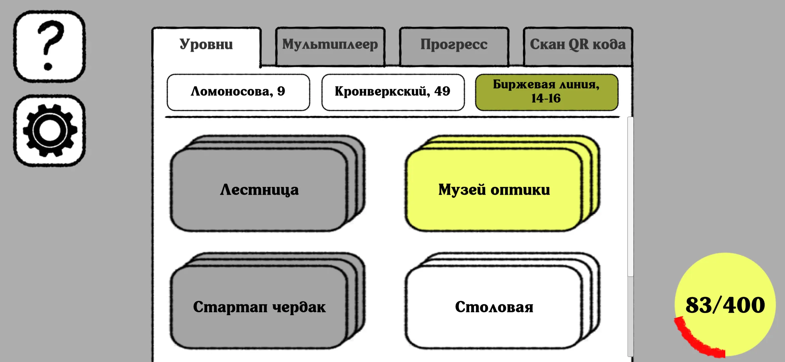

*Рисунок 1 — выбор корпуса и игровых локаций. Интерфейс объединяет три корпуса ИТМО и показывает состояние прохождения.*

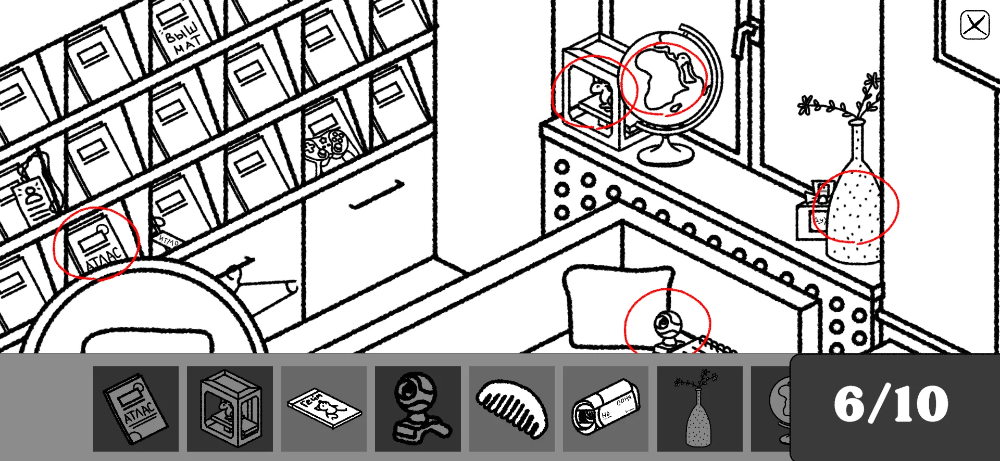

*Рисунок 2 — игровой уровень в библиотеке: панорама университетского пространства, список предметов для поиска и счётчик найденных целей.*

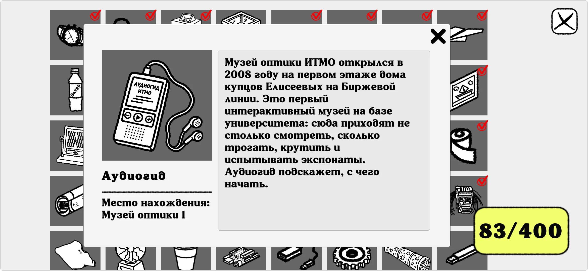

*Рисунок 3 — карточка найденного предмета «Аудиогид» в коллекции. Игровая находка открывает информацию о Музее оптики ИТМО.*

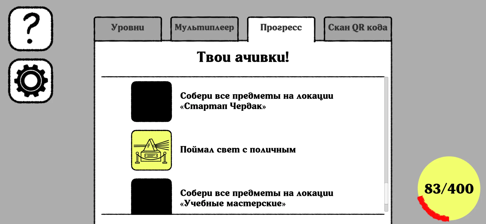

*Рисунок 4 — система достижений. За исследование локаций открываются тематические награды.*

## 1. Кто занимается темой

Тема находится на пересечении адаптации студентов, игрового обучения, мобильных квестов и проектирования пользовательского опыта.

### 1.1. Исследователи и разработчики

| Исследователь | Связь с темой | Работа |
|---|---|---|
| Татьяна Львовна Стенина | Организация образовательной среды и обратной связи при адаптации первокурсников | [Адаптация первокурсников в образовательной среде вуза](https://journals.mosgu.ru/zpu/article/view/227), источник 1 |
| Ю. В. Корнилов | Совместно с И. П. Левиным рассматривает разработку образовательных веб-квестов | [Геймификация и веб-квесты](https://science-education.ru/article/view?id=26865), источник 3 |
| Sebastian Deterding | Соавтор определения геймификации и разграничения игровых подходов | [From game design elements to gamefulness](https://gamification-research.org/2012/04/defining-gamification/), источник 6 |
| Julia Gressick | Соавтор QR-квеста для знакомства студентов с новым зданием кампуса | [Designing interactive scavenger hunt using QR codes](https://scholarworks.iu.edu/journals/index.php/jotlt/article/view/4239), источник 7 |
| Michael Sailer | Соавтор метаанализа влияния геймификации на результаты обучения | [The Gamification of Learning](https://link.springer.com/article/10.1007/s10648-019-09498-w), источник 9 |

### 1.2. Организации

| Организация                   | Связь с темой                                                                                                | Источник                                                                                     |
| ----------------------------- | ------------------------------------------------------------------------------------------------------------ | -------------------------------------------------------------------------------------------- |
| Университет ИТМО              | Развивает цифровые сервисы университетской среды, включая навигатор itmo.map                                 | [Цифровые сервисы ИТМО](https://student.itmo.ru/ru/services/digital)                         |
| Indiana University South Bend | Место работы авторов QR-квеста для знакомства с университетским зданием                                      | [Публикация авторов](https://scholarworks.iu.edu/journals/index.php/jotlt/article/view/4239) |
| Holon Institute of Technology | Авторы из института разработали и исследовали адаптационный маршрут на основе Treasure-HIT                   | [Доклад на ICCE 2014](https://library.apsce.net/index.php/ICCE/article/view/419)             |
| Actionbound                   | Разрабатывает платформу мобильных квестов; на ней опубликован ознакомительный маршрут University of Brighton | [Университетский маршрут](https://en.actionbound.com/bound/MediaStudiesFreshers)             |

### 1.3. Конференции

| Конференция | Пример работы по теме | Связь с ВКР |
|---|---|---|
| International Academic MindTrek Conference | Deterding et al., 2011, источник 6; [авторская страница](https://gamification-research.org/2012/04/defining-gamification/) | Понятийная основа игрового проектирования |
| International Conference on Computers in Education — ICCE | Ronen, Hammer, Kohen-Vacs, 2014, источник 8; [страница доклада](https://library.apsce.net/index.php/ICCE/article/view/419) | Мобильные игры для знакомства новых студентов с кампусом |

### 1.4. Научные журналы

| Журнал | Пример публикации | Связь с ВКР |
|---|---|---|
| Знание. Понимание. Умение | [Стенина, 2016](https://journals.mosgu.ru/zpu/article/view/227), источник 1 | Адаптация студентов к вузовской среде |
| Journal of Teaching and Learning with Technology | [Gressick et al., 2014](https://scholarworks.iu.edu/journals/index.php/jotlt/article/view/4239), источник 7 | Практическая организация QR-квеста |
| Educational Psychology Review | [Sailer, Homner, 2020](https://link.springer.com/article/10.1007/s10648-019-09498-w), источник 9 | Оценка результатов геймификации |
| Educational Technology Research and Development | [Dai, Xu, Xing, 2025](https://link.springer.com/article/10.1007/s11423-025-10493-y), источник 10 | Подбор сочетаний игровых элементов |

## 2. Обзор литературы

Рассмотрены десять научных публикаций: пять русскоязычных и пять англоязычных. Использованы страницы издателей, университетские репозитории, открытые тексты и авторские аннотации. Учитываются различия между обучением учебным дисциплинам и знакомством с университетом. Дата обращения к электронным источникам — 21 октября 2026 года.

### 2.1. Русскоязычные источники

**1. Стенина Т. Л.** Адаптация первокурсников в образовательной среде вуза как период эволюционных преобразований (на примере Ульяновского государственного технического университета) // Знание. Понимание. Умение. 2016. № 1. С. 243–253. DOI: [10.17805/zpu.2016.1.20](https://doi.org/10.17805/zpu.2016.1.20). [Статья](https://journals.mosgu.ru/zpu/article/view/227).

Рассматривается адаптация как взаимодействие студента с образовательной средой; используются опросы, наблюдение и другие способы обратной связи. В ВКР этот подход раскрывается через освоение университетского пространства, знакомство с полезной информацией и взаимодействие с другими участниками. Для оценки результата используются показатели знания локаций и фактов об ИТМО.

**2. Варенина Л. П.** Геймификация в образовании // Историческая и социально-образовательная мысль. 2014. Т. 6. № 6, ч. 2. С. 314–317. DOI: [10.17748/2075-9908-2014-6-6_2-314-317](https://doi.org/10.17748/2075-9908-2014-6-6_2-314-317). [Статья](https://s.hist-edu.ru/index.php/hist/article/view/1317).

Обсуждаются функции игры, мотивация и вовлечение в образовательную деятельность. Рассмотренные подходы обосновывают использование игровых заданий для активного знакомства с новой средой. В my.adapt эта идея реализована через поиск университетских локаций, предметов и информации, открывающейся при пополнении коллекции.

**3. Корнилов Ю. В., Левин И. П.** Геймификация и веб-квесты: разработка и применение в образовательном процессе // Современные проблемы науки и образования. 2017. № 5. URL: [страница статьи](https://science-education.ru/article/view?id=26865). [Открытый текст](https://s.science-education.ru/pdf/2017/5/26865.pdf).

Рассматривается образовательный квест как сценарий с ролями, заданиями и условиями прохождения; описывается его создание с помощью AXMA Story Maker. Для ВКР значим принцип согласования содержания и игровых действий. В my.adapt прохождение связывает посещение университетского пространства, визуальный поиск и получение информации об ИТМО.

**4. Белкин Ф. А.** Геймификация в образовании // Современная зарубежная психология. 2016. Т. 5. № 3. С. 28–34. DOI: [10.17759/jmfp.2016050302](https://doi.org/10.17759/jmfp.2016050302). [Статья](https://psyjournals.ru/journals/jmfp/archive/2016_n3/83892).

Показаны направления применения образовательных видеоигр и подходы к оценке их влияния на обучающегося. Для ВКР значимо разделение вовлечённости, интереса и усвоения информации. Поэтому апробация игры включает входное и выходное тестирование, позволяющее сопоставить знание фактов об ИТМО и знакомство с университетскими локациями.

**5. Болтышев М. Г.** Геймификация в образовательном пространстве: неоднозначность трактовок и методологии // Мир психологии. 2022. № 2 (109). С. 46–54. DOI: [10.51944/20738528_2022_2_46](https://doi.org/10.51944/20738528_2022_2_46). [Карточка публикации](https://publications.hse.ru/articles/716248520).

Работа разграничивает геймификацию и смежные способы применения игр в образовании. Это помогает точнее описать my.adapt: продукт является самостоятельной игрой с образовательным назначением, а его использование в процессе знакомства с университетом вносит игровые элементы в этот процесс. Рейтинг и достижения должны быть связаны с содержательной задачей проекта.

### 2.2. Иностранные источники

**6. Deterding S., Dixon D., Khaled R., Nacke L. E.** From game design elements to gamefulness: defining “gamification” // Proceedings of the 15th International Academic MindTrek Conference: Envisioning Future Media Environments. New York: ACM, 2011. P. 9–15. DOI: [10.1145/2181037.2181040](https://doi.org/10.1145/2181037.2181040). [Авторская страница](https://gamification-research.org/2012/04/defining-gamification/). [Текст в репозитории соавтора](https://uwaterloo.ca/scholar/sites/ca.scholar/files/lnacke/files/From_game_design_elements_to_gamefulness-_defining_gamification.pdf).

Авторы определяют геймификацию через применение элементов игрового дизайна вне собственно игрового контекста и соотносят её с соседними понятиями. Источник задаёт терминологию: следует отдельно описывать саму игру и процесс знакомства с университетом, который она дополняет. В my.adapt механика Hidden Object (поиск предметов) объединена с QR-маршрутом и информационной коллекцией, образуя целостный сценарий знакомства с университетом.

**7. Gressick J., Spitzer B. A., Sagarsee K.** Designing interactive scavenger hunt using QR codes // Journal of Teaching and Learning with Technology. 2014. Vol. 3. No. 1. P. 90–93. DOI: [10.14434/jotlt.v3n1.4239](https://doi.org/10.14434/jotlt.v3n1.4239). [Статья](https://scholarworks.iu.edu/journals/index.php/jotlt/article/view/4239).

Описан интерактивный QR-квест с Google Forms и таблицами для повторения информации и знакомства с новым зданием кампуса. Это близкий пример связи физического пространства с цифровым заданием. Для ВКР полезен механизм подтверждения посещения точки через QR-код; игровое наполнение и университетский контент требуют самостоятельного проектирования.

**8. Ronen M., Hammer R., Kohen-Vacs D.** Feeling at Home form the First Day: Using Mobile Location-Based Games for Welcoming New Students // Proceedings of the 22nd International Conference on Computers in Education — ICCE 2014. 2014. P. 423–431. DOI: [10.58459/icce.2014.419](https://doi.org/10.58459/icce.2014.419). [Доклад](https://library.apsce.net/index.php/ICCE/article/view/419).

Исследуется командный маршрут для новых студентов на основе Treasure-HIT. Участники посещают точки кампуса и выполняют задания; для помещений предусмотрено подтверждение прибытия штрихкодом. Для ВКР полезно сочетание освоения пространства с общением. Исследование обосновывает включение реального перемещения и общения в игровой сценарий университетского знакомства.

**9. Sailer M., Homner L.** The Gamification of Learning: a Meta-analysis // Educational Psychology Review. 2020. Vol. 32. P. 77–112. DOI: [10.1007/s10648-019-09498-w](https://doi.org/10.1007/s10648-019-09498-w). [Открытый текст](https://link.springer.com/article/10.1007/s10648-019-09498-w).

Метаанализ обнаруживает положительные эффекты геймификации для ряда результатов обучения, но показывает различия между когнитивными, мотивационными и поведенческими показателями. Для проекта это основание оценивать знания, самооценку ориентирования и вовлечённость раздельно. Полезно рассматривать соревнование вместе с возможностями сотрудничества. В my.adapt эти направления представлены поиском QR-кодов в корпусах, информационной коллекцией, достижениями и соревновательным режимом.

**10. Dai W.-A., Xu W., Xing Q.-W.** Gamified learning impact: a meta-analysis of game element combinations on students’ learning outcomes // Educational Technology Research and Development. 2025. Vol. 73. P. 2617–2643. DOI: [10.1007/s11423-025-10493-y](https://doi.org/10.1007/s11423-025-10493-y). [Страница и аннотация издателя](https://link.springer.com/article/10.1007/s11423-025-10493-y).

Метаанализ посвящён сочетаниям игровых элементов и их связи с результатами обучения. В исследовании рассматриваются роль области обучения и длительности игрового взаимодействия. Для ВКР значима согласованность целей, поисковых задач и исследования: QR-маршрут, поиск предметов, коллекция и рейтинг объединены в общий сценарий знакомства с ИТМО.

### 2.3. Выводы по обзору

Адаптация включает несколько процессов. Область применения my.adapt — освоение университетского пространства и знакомство с информацией о возможностях ИТМО. Исследования QR-квестов и мобильных маршрутов показывают существование подхода, соединяющего посещение реальных точек с цифровыми заданиями [1, 7, 8].

Для проекта выбраны следующие решения:

1. **QR-коды у значимых локаций** связывают открытие цифрового контента с посещением реального места.
2. **Рисованные панорамы реальных пространств** включают узнаваемое университетское окружение в игровое действие и связывают посещённую локацию с её цифровым образом.
3. **Hidden Object и коллекция** дают повторяемую задачу и сохраняют информационные карточки для последующего чтения.
4. **Прогресс, достижения и рейтинг** предоставляют обратную связь, показывают результаты прохождения и формируют дополнительные игровые цели.
5. **Входное и выходное тестирование сопоставленных участников** позволяет описать изменения знаний; вопросы о знакомстве с локациями анализируются отдельно как самооценка.

Обзор определил основу проекта: активное исследование кампуса, содержательные игровые задания, информационные награды и оценка результатов прохождения. Вклад ВКР заключается в реализации и обосновании сочетания QR-маршрута, визуального поиска и постоянной коллекции для трёх корпусов ИТМО. Такое решение объединяет физическое знакомство с университетом и цифровой игровой опыт.

## 3. Обзор и сравнение аналогов

### 3.1. Прямые аналоги

В качестве прямых аналогов рассмотрены университетские мобильные квесты, соединяющие посещение реальных локаций с цифровыми заданиями. Их устройство описано в научных публикациях [7, 8].

**QR-квест Indiana University South Bend.** В работе Gressick и соавторов [7] посещение университетского здания соединяется с QR-кодами и информационными заданиями. Решение близко по задаче и способу связи с пространством. Оно относится к другому кампусу; для ИТМО потребовались бы новые маршрут и содержание. Поиск предметов в панорамах и постоянная коллекция не описаны.

**Адаптационная игра на Treasure-HIT.** В работе Ronen и соавторов [8] команды знакомятся с кампусом через посещение станций и выполнение заданий. Для проекта полезна идея совместного исследования. Описанный маршрут организован для другого вуза и конкретного вводного мероприятия. Панорамный поиск предметов и информационная коллекция в рассмотренном описании не представлены.

### 3.2. Косвенные аналоги

**Actionbound.** Платформа позволяет создавать мобильные квесты. Рассмотрен пример [University of Brighton, Media Studies 2016: Fresher’s Orientation](https://en.actionbound.com/bound/MediaStudiesFreshers): знакомство со зданиями и окрестностями кампуса, информационные материалы, викторины, задания, QR-коды и результаты участников. Для ИТМО необходимо создавать собственные содержание и маршрут. Основные задания рассмотренного примера — викторины и миссии. Платформа предоставляет основу для проведения маршрута, тогда как в my.adapt разработаны собственные панорамы, поисковая механика и коллекция предметов с информацией об ИТМО.

**itmo.map.** Навигатор помогает искать помещения и строить маршруты; он представлен среди [цифровых сервисов ИТМО](https://student.itmo.ru/ru/services/digital). Навигационная задача описана [разработчиком в App Store](https://apps.apple.com/ru/app/itmo-map/id1642082361). my.adapt дополняет этот сценарий мотивацией исследовать университет и открывать информацию через игру. Рассмотренные описания itmo.map не заявляют панорамный поиск предметов и коллекцию. Основное назначение навигатора — помощь в поиске нужного места; в my.adapt исследование университетского пространства организовано как игровой маршрут.

### 3.3. Таблица сравнения

Выбраны критерии, связанные с целью проекта: знакомство с университетом, посещение реального пространства, игровое действие, повторный доступ к информации, соревнование и объём адаптации под ИТМО. Критерии отражают связь цифрового продукта с университетским пространством, содержание игрового опыта и возможности повторного обращения к информации.

Характеристики аналогов сопоставлены по опубликованным описаниям; отметка «не описано» сохраняется для функций, не представленных в этих материалах.

| Критерий                                       | QR-квест IU South Bend [7] | Treasure-HIT, маршрут [8] | Actionbound, пример Brighton | itmo.map               | my.adapt, реализованная версия  |
| ---------------------------------------------- | -------------------------- | ------------------------- | ---------------------------- | ---------------------- | ------------------------------- |
| Знакомство новых студентов с кампусом          | Да                         | Да                        | Да                           | Навигационная помощь   | Да, ИТМО                        |
| Связь с реальными точками                      | QR-коды                    | Станции, GPS и штрихкоды  | Точки и QR-задания           | Карты и маршруты       | QR-коды в трёх корпусах         |
| Основное действие                              | Поиск точек и ответы       | Командный поиск и задания | Викторины и миссии           | Поиск места и маршрута | Поиск предметов в панораме      |
| Постоянная коллекция информационных предметов  | Не описана                 | Не описана                | Не описана                   | Не заявлена            | Реализована                     |
| Поиск предметов в рисованных панорамах кампуса | Не описан                  | Не описан                 | Не описан                    | Не заявлен             | Реализован                      |
| Соревнование и сравнение результатов           | Не уточнено                | Командный формат          | Турнир и результаты          | Не заявлены            | Режим на время и онлайн-рейтинг |
| Содержание об ИТМО                             | Требуется подготовить      | Требуется подготовить     | Требуется подготовить        | Университетские карты  | Подготовлено для трёх корпусов  |

Источники по Actionbound: [маршрут Brighton](https://en.actionbound.com/bound/MediaStudiesFreshers) и [инструкция запуска](https://en.actionbound.com/startguide/MediaStudiesFreshers.pdf). По itmo.map: [страница ИТМО](https://student.itmo.ru/ru/services/digital) и [описание разработчика](https://apps.apple.com/ru/app/itmo-map/id1642082361).

### 3.4. Выводы по сравнению

Практическая ценность my.adapt заключается в объединении университетского маршрута с самостоятельной игрой в жанре Hidden Object. Реализована связка «посещение реальной локации → открытие панорамы → визуальный поиск → информационная карточка → постоянная коллекция». Для трёх корпусов ИТМО подготовлены игровые пространства и содержательные материалы, связанные с университетской жизнью.

Из аналогов применимы подтверждение посещения кодом, привязка заданий к инфраструктуре и социальное взаимодействие участников. Универсальные платформы сокращают необходимость разработки базового механизма квеста. Самостоятельная разработка my.adapt обоснована необходимостью управлять взаимосвязанными панорамами, поисковой механикой, коллекцией и университетским содержанием.

Назначение игры — мотивировать исследование университетских пространств и знакомство с возможностями ИТМО. Она дополняет навигационные сервисы игровыми заданиями, коллекцией и системой достижений.

## 4. Итоги

**Итоговая тема ВКР:** Разработка мобильной игры для адаптации студентов в университете ИТМО.

**УДК для тезиса:** 004.42:378 — программирование в связи с высшим образованием. Индекс выбран для программного результата и его университетской области применения.

**Ключевые слова:** мобильная игра; адаптация студентов; университетская навигация; QR-квест; Hidden Object; игровое обучение; коллекция предметов; Unity; ИТМО.

### 4.1. Актуальность исследования

При поступлении студенту необходимо освоить расположение помещений и получить представление о сервисах и возможностях вуза. Исследования рассматривают адаптацию как взаимодействие с образовательной средой и подчёркивают роль активного участия и обратной связи [1]. Мобильные квесты позволяют включить знакомство с инфраструктурой в самостоятельное исследование [7, 8].

Для ИТМО задача связана с распределением учебной деятельности между несколькими корпусами. Указатели, справочные материалы и itmo.map помогают решить конкретный навигационный запрос, но студенту также нужен повод посетить полезные места, которые он ещё не знает. В my.adapt такой повод создают открытие локаций, поиск предметов и пополнение коллекции.

Игровое обучение остаётся предметом исследований, включая метаанализ 2025 года [9, 10]. Результаты зависят от содержания, сочетания механик и условий использования. Актуальна разработка конкретного решения с явным разделением целей: исследование пространства, знакомство с информацией и игровая вовлечённость.

В 2024 году был проведён предпроектный опрос **92 студентов ИТМО**. Первокурсники составили **82,6%** выборки, что соответствует основной целевой аудитории проекта (рисунок 5).

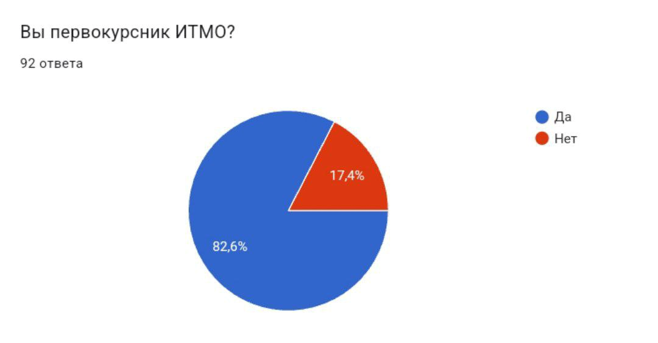

*Рисунок 5 — состав выборки предпроектного опроса: 82,6% участников — первокурсники ИТМО; всего 92 ответа.*

Частые трудности с поиском нужной аудитории после поступления отметили **58 участников из 92 — 63,0%**. Они выбрали оценки 4 или 5 по шкале частоты (рисунок 6). Это подтверждает потребность в инструментах знакомства с университетским пространством.

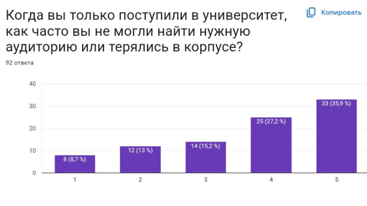

*Рисунок 6 — частота затруднений с поиском аудитории и ориентированием в корпусе после поступления. Шкала: 1 — никогда, 5 — постоянно. Оценки 4–5 выбрали 63,0% респондентов.*

Идею мобильной игры для адаптации положительно оценили **74 участника — 80,4%**: они поставили 4 или 5 баллов (рисунок 7). **69 участников — 75%** сообщили о готовности пользоваться такой игрой (рисунок 8). Результаты подтвердили интерес аудитории к предложенному формату и послужили основанием для разработки.

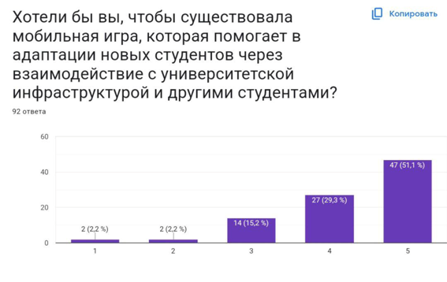

*Рисунок 7 — отношение к идее мобильной игры для адаптации. Шкала: 1 — плохая идея, 5 — очень хорошая идея. Положительные оценки 4–5 дали 80,4% участников.*

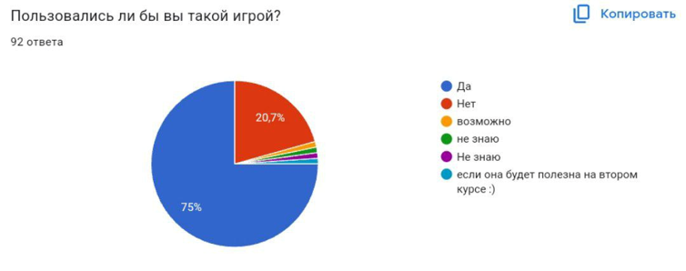

*Рисунок 8 — готовность пользоваться мобильной игрой для адаптации: ответ «Да» выбрали 75% респондентов.*

### 4.2. Цель исследования

Разработать и обосновать мобильную игру для знакомства первокурсников и абитуриентов с пространством и возможностями Университета ИТМО, объединяющую QR-маршрут по реальным корпусам, поиск предметов в панорамных уровнях и коллекцию информационных карточек.

### 4.3. Задачи исследования

1. Изучить особенности знакомства первокурсников и абитуриентов с университетской средой, научные подходы и результаты собственных опросов.
2. Проанализировать прямые и косвенные аналоги, определить область применения игры и критерии сравнения.
3. Сформулировать требования и спроектировать структуру контента, взаимодействие модулей и хранение прогресса.
4. Реализовать QR-сканирование, открытие локаций, панорамный поиск предметов, коллекцию, достижения и сохранение состояния.
5. Подготовить материалы для корпусов на Ломоносова, Кронверкском проспекте и Биржевой линии, реализовать соревновательный режим и сетевой рейтинг с веб-представлением.
6. Проверить основные сценарии и оценить результаты апробации по знаниям об ИТМО, знакомству с локациями и взаимодействию участников.

Задачи описывают полный цикл ВКР. Основной программный результат уже реализован; в рамках семинара систематизируются его обоснование, проектирование и проверка. Предыдущие этапы разработки учитываются как имеющийся задел.

### 4.4. Имеющийся задел и апробация

Разработка была выполнена в три этапа: сначала подготовлен корпус на Ломоносова, затем на Кронверкском проспекте, после чего добавлен корпус на Биржевой линии. Проект стал победителем конкурса «Твой Ход» и получил поддержку по программе «Студенческий стартап». В результате была создана работающая игра с университетским контентом, постоянной коллекцией, достижениями, онлайн-рейтингом и публичным сайтом.

**Входное и выходное тестирование, 2025 год.** Для оценки результатов прохождения игры были проведены два тестирования: входное — до игры, выходное — после. Получены **74 входные и 53 выходные анкеты** в период с 22 июня по 29 июля 2025 года. Для сопоставимости результатов в сравнение включены только респонденты, прошедшие оба тестирования. Участники сопоставлены по введённым именам или никнеймам.

**Знания об университете.** После прохождения игры выросла доля правильных ответов на все восемь представленных вопросов об инфраструктуре, правилах и возможностях ИТМО (рисунок 9). Результаты показывают рост осведомлённости участников по темам, включённым в игровой контент.

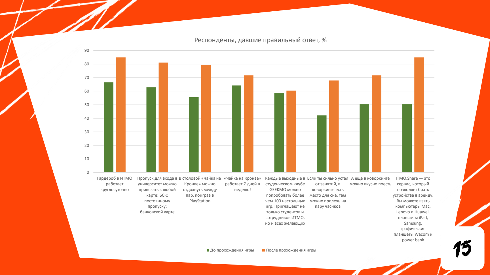

*Рисунок 9 — доля правильных ответов на вопросы об ИТМО до и после прохождения игры. Зелёные столбцы — входное тестирование, оранжевые — выходное.*

**Ориентирование в корпусе.** По всем пяти локациям увеличилась доля участников, сообщивших, что знают, как до них добраться (рисунок 10). По отдельным локациям показатель вырос примерно **втрое**. Таким образом, прохождение квеста сопровождалось улучшением знакомства с университетским пространством.

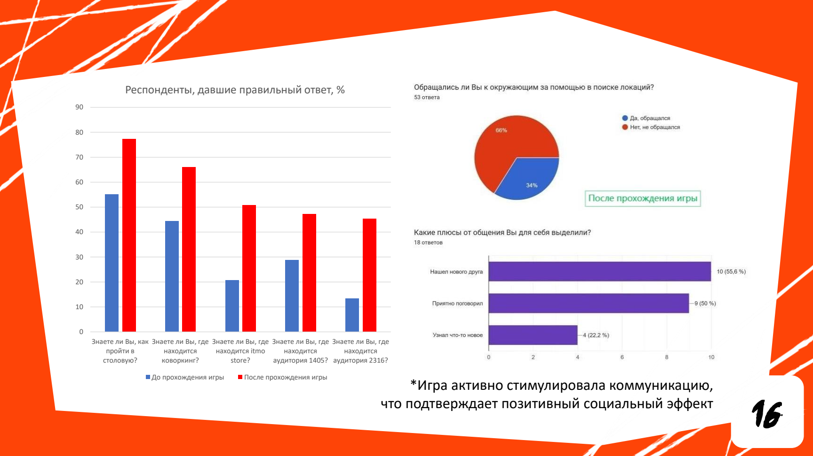

*Рисунок 10 — знакомство участников с расположением столовой, коворкинга, itmo store и аудиторий до и после прохождения игры. Синие столбцы — до игры, красные — после. Показатель отражает самооценку знания пути к локации.*

**Общение участников.** За помощью в поиске локаций обратились **18 из 53 участников выходного опроса — 34%**. Среди этих 18 участников **10 человек (55,6%)** отметили, что нашли нового друга, **9 (50%)** — что приятно поговорили, **4 (22,2%)** — что узнали что-то новое (рисунок 11). Допускался выбор нескольких вариантов, поэтому проценты не суммируются до 100%. Квест создал поводы для знакомства и взаимопомощи во время исследования университета.

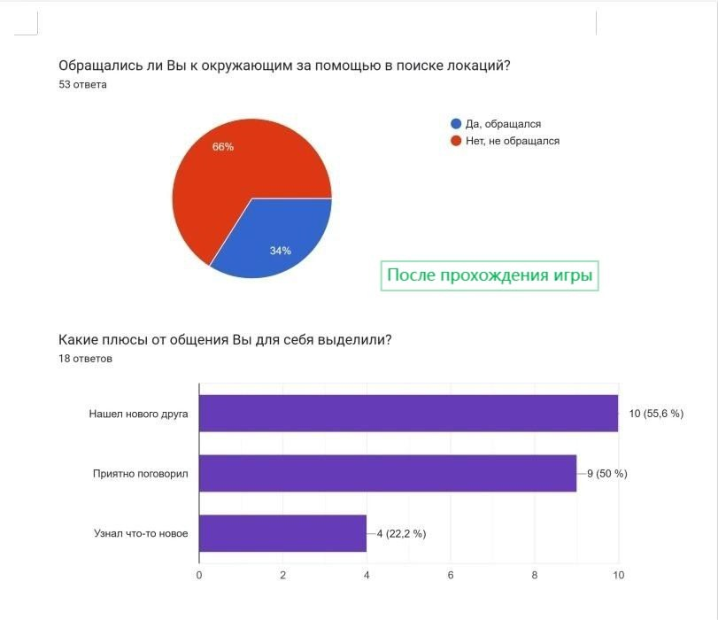

*Рисунок 11 — общение во время поиска локаций. Верхняя диаграмма: обращения за помощью, 53 ответа. Нижняя диаграмма: отмеченные результаты общения, 18 ответов, множественный выбор.*

Сопоставление выполнено в формате «до/после» без контрольной группы. Знания об университете оценивались по правильности ответов, а знакомство с локациями — по ответам самих участников. Тестирование проведено для версии с двумя корпусами; затем игровой контент расширен на Биржевую линию.

### 4.5. Датасеты и сервисы

| Данные или сервис                   | Назначение                                               | Состав                                                                                                                                                                     |
| ----------------------------------- | -------------------------------------------------------- | -------------------------------------------------------------------------------------------------------------------------------------------------------------------------- |
| Предпроектный опрос, 2024 год       | Выявление навигационных затруднений и интереса к формату | Опрос в гугл формах — 92 записи (студенты и абитуриенты ИТМО)                                                                                                              |
| Входной и выходной опросы, 2025 год | Проверка знаний и самооценки знакомства с локациями      | 74 и 53 записи                                                                                                                                                             |
| UX-наблюдения                       | Выявление трудностей взаимодействия                      | Четыре участника; замечания о коллекции, состоянии уровней, обучении и управлении                                                                                          |
| Панорамы и предметы                 | Содержание уровней и коллекции                           | Собственные материалы для 20 локаций и 60 панорам                                                                                                                          |
| Реестр локаций и QR-кодов           | Связь университетского места с цифровым контентом        | Собственные идентификаторы и соответствия локаций                                                                                                                          |
| Локальное хранение прогресса        | Продолжение игры между сеансами                          | Открытые локации, предметы, достижения и настройки; используются PlayerPrefs                                                                                               |
| Рейтинг и сайт проекта              | Сравнение результатов и публичное представление          | [Сайт](https://итмоигравадаптацию.рф/), [таблица лидеров](https://итмоигравадаптацию.рф/leaderboard.html). Передача и чтение результатов связывают приложение с веб-частью |

Игровое содержание, схемы локаций и опросы используются как собственные данные предметной области и оценки продукта.

### 4.6. Итоговый вывод

Была разработана и реализована мобильная игра для знакомства с пространством и возможностями ИТМО. Предпроектный опрос подтвердил востребованность игрового формата, а входное и выходное тестирование показали рост осведомлённости об университетских локациях и фактах. Научные публикации и сравнение аналогов обосновывают выбранное сочетание QR-маршрута, панорамного поиска и информационной коллекции. Готовая версия для трёх корпусов, публичный сайт и результаты апробации формируют практическую основу ВКР и последующего описания требований и моделей системы в ЛР 3.
